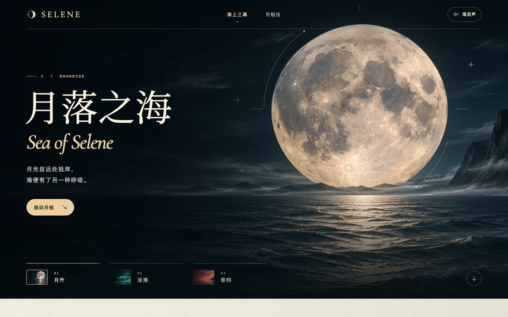
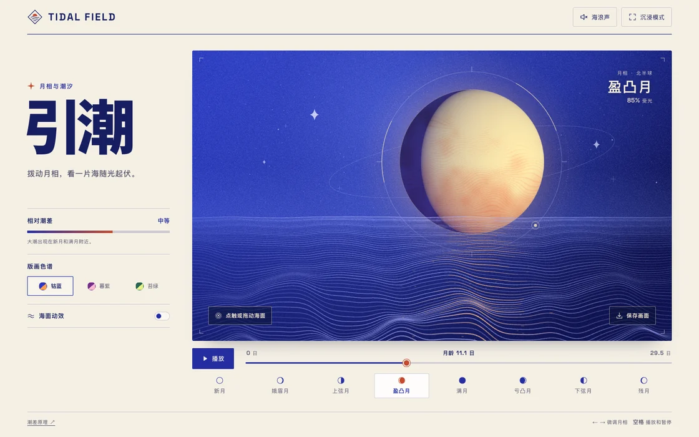
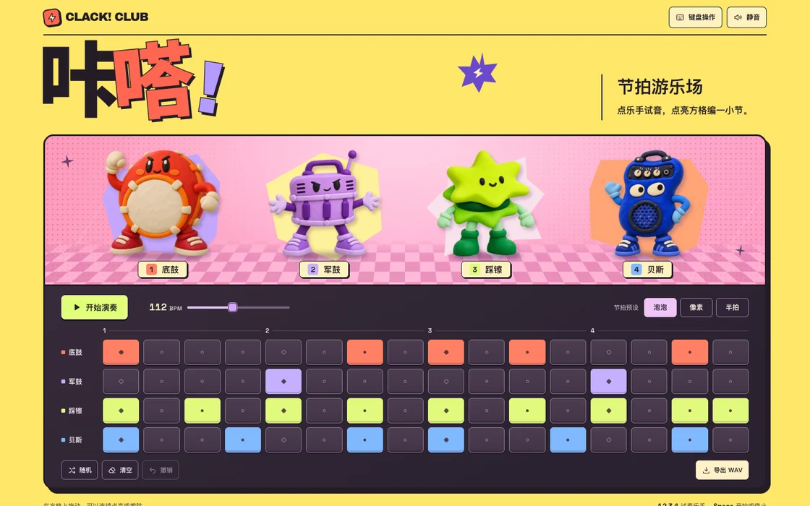
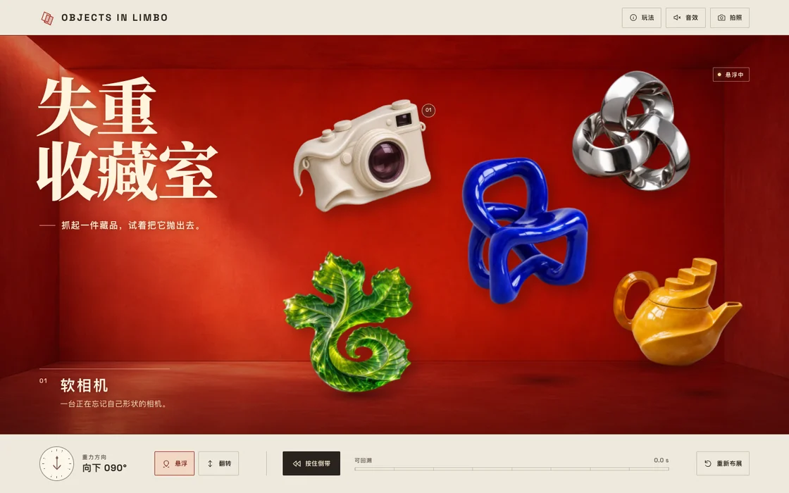
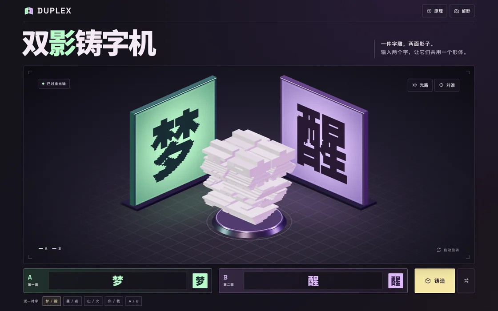
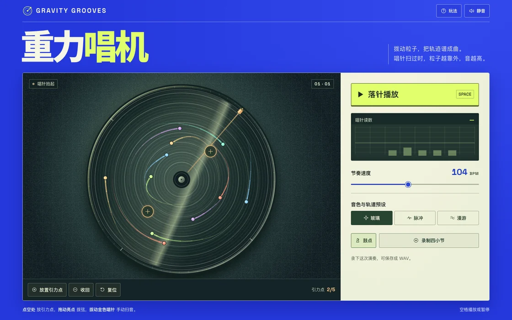
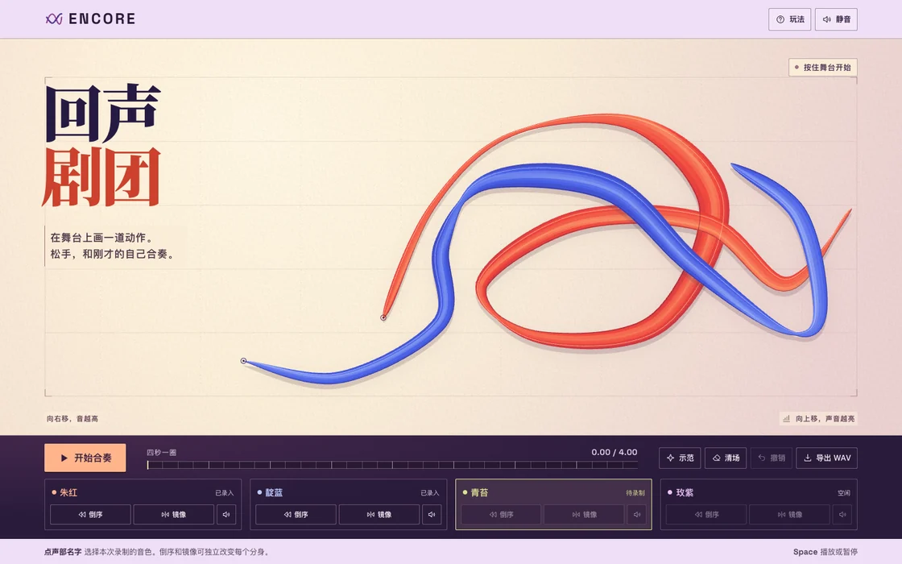

# html demo

**七个可以离线玩的单文件 HTML。每个作品都把一种输入变成可见、可听或可反复操作的结果。** 
**Seven offline, single-file HTML experiences. Each turns a gesture or input into something visible, audible, or replayable.**

[快速开始 / Quick start](#quick-start) · [作品一览 / Gallery](#gallery) · [作品复刻提示词 / Recreation prompts](#recreation-prompts) · [通用提示词 / Reusable prompts](#reusable-prompts) · [原始图像提示词 / Original image prompts](docs/image-prompts.md)

## 快速开始 / Quick start

### 中文

1. 在 GitHub 点 **Code → Download ZIP**，解压后双击 [demos](demos/) 中任意一个 HTML。也可以进入某个 HTML 的文件页，下载原始文件。
2. 用浏览器打开本地文件。每个作品各自带齐运行所需的样式、脚本和资源，适合单独分享。声音在播放、试音或开启音效等主动操作后启动。
3. 第一次玩音乐作品可以先从预设开始。试试《咔嗒！》的「开始演奏」、《重力唱机》的「落针播放」，或在《回声剧团》的舞台上画一笔，停一下再继续。

### English

1. Choose **Code → Download ZIP**, extract it, and open any HTML under [demos](demos/). You can also download the raw file from an individual demo's file page.
2. Open it locally in a browser. Each file includes its own runtime styles, scripts, and assets, so you can share it on its own. Sound begins after a gesture such as pressing play, auditioning an instrument, or enabling effects.
3. For a first listen, start with a preset in CLACK!, drop the needle in Gravity Grooves, or draw a stroke with a deliberate pause in Encore.

Clone / 克隆

~~~bash
git clone https://github.com/yusheng266186-beep/html-demo.git
~~~

## 作品一览 / Gallery

点击预览可以查看对应的 HTML 源文件。图中的画面来自实际运行的作品。 
Click a preview to open the corresponding HTML source. The screenshots were captured from the working demos.

<table>
  <tr>
    <td width="50%"> <strong>月落之海 · Sea of Selene</strong> 三幕海景与实时月相仪 / Three seascapes and a live lunar dial <a href="#prompt-selene">复刻提示词 / Prompt</a></td>
    <td width="50%"> <strong>引潮 · Tidal Field</strong> 随月相变化的动态版画 / A kinetic print shaped by the lunar phase <a href="#prompt-tidal">复刻提示词 / Prompt</a></td>
  </tr>
  <tr>
    <td width="50%"> <strong>咔嗒！· CLACK!</strong> 四个黏土乐手组成的节拍街机 / A beat arcade with four clay performers <a href="#prompt-clack">复刻提示词 / Prompt</a></td>
    <td width="50%"> <strong>失重收藏室 · Objects in Limbo</strong> 可抛掷、可改重力、可倒带的展厅 / A gallery with tossing, rotating gravity, and rewind <a href="#prompt-limbo">复刻提示词 / Prompt</a></td>
  </tr>
  <tr>
    <td width="50%"> <strong>双影铸字机 · Duplex</strong> 一件三维字雕，两束光投出两个字 / One 3D sculpture, two beams, two characters <a href="#prompt-duplex">复刻提示词 / Prompt</a></td>
    <td width="50%"> <strong>重力唱机 · Gravity Grooves</strong> 用引力、粒子和唱针实时作曲 / A live instrument made of gravity, particles, and a needle <a href="#prompt-grooves">复刻提示词 / Prompt</a></td>
  </tr>
  <tr>
    <td width="50%"> <strong>回声剧团 · Encore</strong> 与四秒前的自己合奏 / Duet with yourself from four seconds ago <a href="#prompt-encore">复刻提示词 / Prompt</a></td>
    <td width="50%"><strong>从一个新主题开始 / Start with a new theme</strong> 挑一个交互机制，把共同要求和对应类别模板一起交给编码模型。 Choose an interaction mechanism and pair the common brief with its category template.  <a href="#reusable-prompts">查看七类模板 / Browse seven templates</a></td>
  </tr>
</table>

### 先试哪个动作 / First gestures to try

| 作品 / Demo | 建议的第一次操作 / A good first gesture | 实现线索 / Implementation |
| --- | --- | --- |
| [月落之海](demos/月落之海.html) | 切到「黎明」，然后拖动月相仪，观察同一块月面上移动的明暗交界。 Switch to Dawn, then drag the lunar dial and watch the terminator move across the same lunar surface. | 原创光栅叙事、球面光照、Web Audio 海浪 / Original raster scenes, spherical lighting, synthesized surf |
| [引潮](demos/引潮.html) | 在涨落的线条间拖一下，再从上弦拖到满月。 Drag through the moving lines, then scrub from first quarter to full moon. | Canvas 潮线、局部波纹、相对潮差示意 / Canvas contours, local ripples, illustrative relative tidal range |
| [咔嗒！](demos/咔嗒.html) | 播放预设后，用 <code>1</code>–<code>4</code> 试奏四位乐手，再拖过一行方格。 Play a preset, audition the four performers with <code>1</code>–<code>4</code>, then drag across a row of pads. | Web Audio 合成、十六步时钟、弹簧动作 / Web Audio synthesis, a 16-step clock, spring animation |
| [失重收藏室](demos/失重收藏室.html) | 把软相机抛向蓝椅，按住 <code>R</code> 倒带，再从中途换个方向抛。 Throw the soft camera toward the blue chair, hold <code>R</code> to rewind, and throw it differently from an earlier moment. | 二维动力学、状态快照、构图导出 / 2D dynamics, state snapshots, composition export |
| [双影铸字机](demos/双影铸字机.html) | 先看「梦 / 醒」，再铸造 <code>A / B</code>。旋转以后点「对准」。 Start with Dream / Wake, cast <code>A / B</code>, then rotate and realign the sculpture. | 体素交集、正交投影、WebGL 与 Canvas / Voxel intersections, orthographic projections, WebGL and Canvas |
| [重力唱机](demos/重力唱机.html) | 落针后移走一个金环，再抓唱针来回扫音。 Drop the needle, move a gold attraction ring, then scrub the needle by hand. | 粒子轨迹、越线检测、量化触发与现场录制 / Particle motion, crossing detection, quantized triggers and live capture |
| [回声剧团](demos/回声剧团.html) | 画一笔，中间停半秒后继续。下一圈听到停顿，再把声部倒序。 Draw a stroke with a half-second pause. Hear it return on the next loop, then reverse that part. | 带时间戳的轨迹、分轨重排、立体声混音 / Timestamped paths, per-part transformations, stereo mixdown |

### 仓库结构与验证 / Layout and verification

~~~text
README.md                  双语导览、复刻提示词与通用模板 / Bilingual guide and prompt library
LICENSE                    MIT
THIRD_PARTY_NOTICES.md     内嵌字体、库与素材出处 / Embedded fonts, libraries, and asset provenance
demos/                     七个独立 HTML 文件 / Seven standalone HTML files
docs/image-prompts.md      14 条原始图像提示词及译文 / 14 original image prompts with translations
docs/previews/             实际运行截图 / Screenshots of the running demos
~~~

发布副本与原 HTML 逐字节一致。已在 Edge／Chromium 断网环境核对桌面首屏、390 px 触屏布局、字体和画布初始化。各作品的原始验收还覆盖了相应的拖拽、键盘或声音交互。月相和潮汐的外部资料链接在联网时可读，页面本身离线运行。

The published copies match the original HTML files byte for byte. Initial desktop rendering, a 390 px touch layout, fonts, and canvas startup were checked with networking disabled in Edge/Chromium. The original demo checks also exercised the applicable pointer, keyboard, and audio flows. The lunar and tide reference links are optional reading when online.

## 作品复刻提示词 / Demo-specific recreation prompts

下列网页提示词根据交付成品重建，把视觉方向、状态模型、动画和验收写进同一份可执行简报。三件使用 ImageGen 的作品另外保留了 14 条当时实际提交的素材提示词，英文原文和中文译文见下方链接。选任一语言复制整段即可使用。 
The website briefs below were reconstructed from the delivered demos. They combine art direction, state, motion, and acceptance criteria in one runnable brief. The three ImageGen-assisted works also retain all 14 prompts that were actually submitted for their assets, with the English originals and Chinese translations linked below. Copy either complete language block.

### 月落之海 / Sea of Selene

[HTML](demos/月落之海.html) · [四条原始图像提示词 / Four original image prompts](docs/image-prompts.md#selene-images)

中文复刻提示词

~~~text
做一件名为《月落之海》的离线单文件 HTML 展览，面向中文读者。它从一轮巨大而真实的月亮开始，
穿过蓝绿色的午夜潮水，最后进入铜红黎明。全站具有电影摄影集的留白与节奏，
末尾有一件能亲手拨动的月相仪。

首屏全幅，用黑蓝色海、暖象牙色月面和细金线建立识别度。让月亮悬在右侧远山上方，月光落进真实波纹。
左侧保留低反差空间，放宋体大标题和少量衬线英文副题。三幕依次使用银金、青蓝、铜桃色。
准备三张有一致取景逻辑的原创宽屏海景，以及一张正视月面纹理，压缩后内嵌。

把三幕做成底部照片标签。点选和方向键可自由切换，背景、标题和强调色一起过渡。
指针只带来轻微的画面视差，保留一个显眼的「拨动月相」入口。第二部分用细颗粒暖纸与深色观测卡，
延续首屏的精细线条。

用球面明暗计算驱动月相仪。滑杆连续覆盖一个约 29.5 日的周期，八个可点击图标可跳到对应月相。
读数同步显示月龄、受光比例和阶段，播放按钮可循环演示。北半球示意的明暗交界沿同一月面移动。
用 Web Audio 合成可开关的海浪底噪，初始静音。

把字体、图片、样式和脚本都内嵌。确认手机裁切后主月亮、正文和切换按钮仍可见。断网验收三幕切换、
海浪开关、连续拖动和八个阶段，再测试键盘切换标签与滑杆。尊重系统减少动态效果设置。
~~~

English recreation prompt

~~~text
Build Sea of Selene as a single offline HTML exhibition for Chinese-speaking readers. Begin
with a monumental photoreal moon, cross a bioluminescent midnight tide, and end at a copper
dawn. Give the experience the pacing and typography of a cinematic photo essay, with a lunar
instrument visitors can operate directly.

Make the opening full-bleed with ink-blue water, a warm ivory lunar disk, and fine brass
drafting lines. Hang the moon over the mountains on the right and show believable light across
the ripples. Keep the left side low contrast for a large Song-style Chinese title and a
restrained serif English subtitle. Grade the scenes in silver-gold, teal-blue, and
copper-peach. Prepare three matching panoramic artworks and one front-facing lunar texture.
Compress and embed all four.

Use photo tabs along the bottom for Moonrise, High Tide, and Dawn. Clicks and arrow keys
switch scenes. Crossfade the art, titles, and accent colors together, with gentle pointer
parallax. Add a clear jump to the lunar dial. Give that section warm textured paper, a dark
instrument plate, and the same fine-line visual language.

Drive the dial with spherical illumination. The slider spans a roughly 29.5-day cycle, and
eight clickable icons jump to representative phases. Update phase name, illumination, and
lunar age together. Add looping playback. In the northern-hemisphere illustration, the
terminator should travel across the same lunar texture. Synthesize optional surf with Web
Audio and start muted.

Embed fonts, art, styles, and scripts. On phones preserve the lunar subject, readable copy,
and reachable scene tabs. Open the file offline and verify all three scenes, sound on and off,
all eight phases, and keyboard navigation. Honor reduced-motion preferences.
~~~

### 引潮 / Tidal Field

[HTML](demos/引潮.html)

中文复刻提示词

~~~text
创作《引潮》，一件以月相与潮汐为主题的动态几何版画，交付单个离线 HTML。首屏借鉴现代主义展览海报，
大字、暖纸、钴蓝和橙黄是识别主线。让版画本身成为可以直接触碰的仪器。

用 Canvas 程序化绘制一轮有明暗交界和版刻纹理的球体。海面由带透视、明暗层次和横向起伏的连续潮线组成。
用克制的纸粒、稀疏星点和轨道细线提供深度。制作钴蓝、暮紫、苔绿三套完整配色，每套同时作用于画布、
读数和控件。

让一个连续的月相变量驱动受光比例、月龄、相对潮差示意和潮线起伏。拖动海面时，
以指针位置为中心创建扩散和衰减的波纹，并让波纹推动附近潮线。提供月相快捷点、自动播放、
动效开关和清楚的滑杆反馈。

实现主动开启的合成海浪声、沉浸查看和当前画面 PNG 保存。移动端保持触摸目标充足，
让舞台先于次要设置。断网核对新月、弦月和满月、涟漪是否随落点、色组切换、键盘操控和导出的 PNG。
~~~

English recreation prompt

~~~text
Create Tidal Field, a kinetic geometric print about phases and tides, in a single offline HTML
file. Set it like a modernist exhibition poster with bold typography, warm paper, cobalt, and
warm orange. The print itself is the instrument visitors operate.

Draw the globe procedurally on Canvas with a spherical terminator and engraved texture.
Construct the sea from continuous perspective contours with depth and horizontal movement. Add
restrained grain, sparse stars, and optical linework. Give Cobalt, Dusk Purple, and Moss Green
complete color systems for canvas, readouts, and controls.

Make one continuous phase value drive illumination, age, an illustrative relative tidal range,
and the motion of the tide lines. A drag on the sea should spawn expanding, decaying ripples
centered at the gesture and displace nearby contours. Include phase shortcuts, playback, a
wave-motion toggle, and clear slider feedback.

Provide optional synthesized surf after a gesture, an immersive view, and PNG export of the
rendered composition. Put the stage before secondary settings on phones and keep touch targets
generous. Verify new moon, quarter moon, and full moon offline, along with ripple origins,
palette transitions, keyboard controls, and the exported pixels.
~~~

### 咔嗒！ / CLACK!

[HTML](demos/咔嗒.html) · [四条原始角色提示词 / Four original character prompts](docs/image-prompts.md#clack-images)

中文复刻提示词

~~~text
制作《咔嗒！节拍游乐场》，一台单个 HTML 就能离线运行的糖果色音乐街机。用柠檬黄、亮粉、
深梅色和高饱和声部色。视觉从夸张字标进入粉色舞台，再落到像硬件音序器的深色方格。

在舞台上摆四个原创黏土乐手。底鼓是橙红鼓身，军鼓是紫色鼓形机器人，踩镲是酸绿色星形叠片，
贝斯是钴蓝色音箱。每个角色使用统一摄影光线和清楚的全身轮廓，采用透明背景并压缩内嵌。
角色也是试奏按钮，触碰、按键或时间轴命中都要触发弹跳和轻微挤压。

实现 4 个声部 × 16 步。鼠标、触屏和键盘都可编辑，按住拖动可连续点亮或擦除。底鼓、军鼓、
踩镲和贝斯使用差异明显的 Web Audio 合成音色。用音频时钟和前瞻排程保持节拍，
播放头及角色动作跟随同一拍。提供 BPM、三组示范、静音、随机、清空与撤销。

移动端可以在两组八步之间切换，保持方格足够大。离线导出当前编排的两小节立体声 WAV。验收点击角色、
1–4 试奏、拖格、撤销、播放中变速、移动端换页和 WAV 文件的真实音频数据。
~~~

English recreation prompt

~~~text
Build CLACK!, an offline candy-colored music arcade contained in one HTML file. Use lemon
yellow, vivid pink, deep plum, and saturated voice colors. Move the visual emphasis from an
oversized wordmark to a pink stage, then to a dark hardware-like step sequencer.

Put four original clay performers on stage. Make the kick player a vermilion drum, the snare a
lilac percussion robot, the hi-hat a stacked lime star, and the bass a cobalt amplifier
creature. Use a consistent studio key light and clear transparent full-body silhouettes. Embed
compressed assets. Each performer is also an audition button, with bounce and squash driven by
touches, keys, and sequenced hits.

Implement four voices and sixteen steps. Let visitors paint or erase several cells by
dragging, and edit via keyboard or touch. Give kick, snare, hi-hat, and bass distinct
synthesized voices. Schedule ahead on the audio clock and drive the playhead and character
animation from the same hit events. Add tempo, three patterns, mute, shuffle, clear, and undo.

Show two banks of eight on phones to preserve tap size. Export two bars of the current
arrangement as stereo WAV. Test audition buttons and keys 1–4, drag and undo, a tempo change
during playback, mobile paging, and actual signal in the WAV.
~~~

### 失重收藏室 / Objects in Limbo

[HTML](demos/失重收藏室.html) · [六条原始展厅与藏品提示词 / Six original environment and sculpture prompts](docs/image-prompts.md#limbo-images)

中文复刻提示词

~~~text
创作《失重收藏室》，把超现实藏品展做成可以抛掷和回溯的离线单文件 HTML。视觉用朱红粉刷混凝土、
侧面斜光、骨白排版与水平展签。五件漂浮物采用不同材质和剪影，包括软瓷相机、蓝瓷扭结椅、镀铬折返镜、
绿玻璃叶和楼梯壶。

展厅使用一张有真实透视的宽幅原创图，物件各自使用独立的透明原创图片。以一致的光线和落影统一素材。
将控件收进展厅下方的浅色操作带，舞台留给物件、留白和标题。选择物件即可查看简短展签。

按住抓取，松手用最近指针速度推算惯性与旋转。以固定步长更新二维动力学、碰撞、边界和轻微阻尼。
用罗盘连续改变重力方向，提供悬浮、翻转和重新布展。每个物件都能用键盘选择和推动。

保留最近约八秒的运动快照。按住倒带往回逐帧恢复位置、速度、角度和重力，松手后从该状态继续，
允许另一种碰撞发生。可开启合成碰撞音效，也可保存当前构图的 PNG。验收抛掷、碰撞、罗盘转向、
倒带后接着抛、复位、触屏和拍照。
~~~

English recreation prompt

~~~text
Create Objects in Limbo as a single offline HTML gallery where surreal collectibles can be
thrown and rewound. Use vermilion pigmented concrete, a diagonal light source, bone-white
typography, and museum labels. Suspend five silhouettes in distinct materials: a soft
porcelain camera, a knotted cobalt chair, a chrome mirror sculpture, a green glass leaf, and a
staircase teapot.

Use wide original architecture art with coherent perspective and separate transparent object
images. Reconcile their light direction and cast shadows. Put controls in a pale rail below
the room, leaving stage space for the objects and title. Selecting a piece reveals its short
label.

Grab with a press and use recent pointer velocity to impart motion and spin on release. Update
a 2D simulation with fixed steps, collisions, boundaries, and damping. Make a compass
continuously change the gravity vector, and provide float, flip, and reset. Support keyboard
selection and nudging for each piece.

Retain about eight seconds of state snapshots. A held rewind restores positions, velocities,
angles, and gravity frame by frame. On release, continue from that state so a different
collision can happen. Add optional synthesized impacts and PNG export of the composition.
Verify tosses, impacts, compass changes, branching after rewind, reset, touch, and image
output.
~~~

### 双影铸字机 / Duplex

[HTML](demos/双影铸字机.html)

中文复刻提示词

~~~text
制作《双影铸字机》，一件字雕在两束相互垂直的平行光下投出两个字。访客可以输入两侧各一个汉字、
字母或符号。交付单个离线 HTML。主画面像深紫黑色的光学实验台，薄荷绿和淡紫投影面斜向观众，
白色立体字雕悬在中间。

将字形光栅化到同一高度，再逐行构造 50 × 50 × 50 的体素空间。每层的实心体素同时满足两侧该层的笔画约
束，针对全空层加极细的辅助线。生成精简网格，并把同一个可转动网格实时投到两个正交方向。
两块缩略投影与舞台来自同一份计算。

铸造时从下到上显现实体，并逐步更新两面投影。拖动画布让字雕产生惯性旋转，投影随夹角连续变形。
点「对准」回到标准位置。提供光路、示例字对和 PNG 保存。让舞台主导首屏，
下方用与屏幕对应的颜色区分 A 面和 B 面输入。

兼容中文输入法的合成状态，输入多于一个字时给明确反馈。提供软件投影路径，
让 WebGL 不可用的浏览器仍能操作。验收「梦 / 醒」「昼 / 夜」及 A / B，
核对旋转前后两边实际像素不同，对准后回到原始投影，手机和键盘都能转动。
~~~

English recreation prompt

~~~text
Build Duplex, where one sculpture casts two characters under perpendicular parallel beams.
Visitors type a single Chinese character, Latin letter, or symbol for each face. Deliver one
offline HTML. Set the stage as a dark violet optics bench with mint and lilac screens, a pale
voxel sculpture, and two angled side views readable from one camera.

Rasterize both glyphs to a shared height and construct a 50 × 50 × 50 voxel space row by row.
Each occupied cell satisfies both silhouettes at its layer. Use thin auxiliary support for
fully blank rows when needed. Build a compact mesh and reproject that same rotatable mesh
along two orthogonal axes. Both thumbnail previews come from the same calculations as the
large screens.

Animate casting from bottom to top and update the projections as the material appears. Give
pointer drags rotational inertia. As the angle changes, both shadows deform continuously.
Alignment returns them to the original masks. Add optical-path lines, sample pairs, and PNG
export. Make the stage the main attraction and match each input area to its screen color.

Handle IME composition and provide feedback for multiple glyphs in one field. Include a
software path for browsers without WebGL. Test Dream / Wake, Day / Night, and A / B. Compare
the rendered shadow pixels before rotation and after realignment, and verify touch and
keyboard operation.
~~~

### 重力唱机 / Gravity Grooves

[HTML](demos/重力唱机.html)

中文复刻提示词

~~~text
做一台《重力唱机》，让用户摆放引力点并用粒子的运动作曲。交付一个离线 HTML。用钴蓝大标题、
酸绿色操作键和深绿黑胶舞台做一台有版刻纹理的唱机。舞台上出现带残影的彩色粒子、金色引力环、
可旋转唱针和与声音对应的读数。

唱针绕中心周期扫过，越过粒子的角位置才生成音符。粒子离中心的距离映射到音阶，横向位置可以决定声像。
让物理更新、单次越线检测和音符排程分层，处理过零点、重复触发和延迟，默认自动旋律贴合节奏网格。

允许在空白处添加引力点，拖动和收回金环，快速甩出粒子，也能拖住唱针倒过去扫音。按键、
触摸和拖动都要给即时的视听反馈。三组预设一起改变音色和轨道，速度、鼓点开关和静音均有实际作用。

录制从下一个小节开始，持续四小节并记下期间真实触发的音符，包括手动扫出的音。
用同一个合成器离线导出立体声 WAV。验收开关鼓点、调整引力后试听、慢扫与反扫、变速、焦点和触屏，
并检查录音中的手动事件与 WAV 数据。
~~~

English recreation prompt

~~~text
Build Gravity Grooves, a single-file offline turntable where moving particles compose music.
Use cobalt typography, acid-green controls, and a dark green etched record. On the record show
colored particle trails, golden attraction rings, a sweeping needle, and a readout connected
to what is heard.

Trigger a note when the needle crosses a particle's angle. Map its distance from the center to
a musical scale and its horizontal position to stereo pan. Separate continuous simulation,
crossing detection, and scheduling. Handle angular wrap, debouncing, and latency. Quantize
automatic notes to a rhythmic grid that follows tempo.

Click empty space to place attraction points, move or remove the rings, flick particles, and
scrub the needle in either direction. Give touch, pointer, and keyboard actions immediate
audiovisual feedback. Include three presets that change both timbre and trajectories, along
with tempo, drums, and mute.

Arm a four-bar recording on the next downbeat. Record real note events heard during the take,
including manual sweeps. Render stereo WAV offline with the same synthesizer. Test drum
toggles, a gravity change, slow and backward sweeps, tempo changes, touch and focus, and
verify that manual events survive in the take.
~~~

### 回声剧团 / Encore

[HTML](demos/回声剧团.html)

中文复刻提示词

~~~text
创作《回声剧团》，一座可以和四秒前的自己合奏的舞台。交付单个离线 HTML。用奶油色幕布、淡紫色页边、
深梅色底座和朱红、靛蓝的实体彩绸。首屏给出两条预设编舞，访客既能先播放，
也能直接拖动画出一个新的分身。

拖动时即时发声，横向位置映射到音阶，纵向位置改变亮度和力度。记录纵横坐标和真实时间戳，
同时保存实际触发的音符。保留静止点，松手后的下一圈让彩绸和音符沿原来的时序回来。
四个声部可以分别录制、倒序、镜像和静音。倒序变换事件时间，镜像变换轨迹并重新映射音高和声像。

用程序绘制带宽度、绸缎褶光和阴影的路径。静止时看见完整编舞，播放时以高光绸段和光点呈现当前时刻。
画布适配触屏直接录制，键盘可以开始记录并移动光点。提供示范、清场、撤销与播放位置反馈。

在用户交互后启动 Web Audio。将当前启用的声部离线混为两圈立体声 WAV。验收画一笔，停半秒再继续，
确认重复循环仍保留停顿与音符间隔。再测试倒序和镜像确实改变音序或音高，
且声部切换与撤销保持数据一致。
~~~

English recreation prompt

~~~text
Create Encore, a stage where visitors can play in time with themselves from four seconds ago.
Deliver a single offline HTML file. Use a cream screen, lilac margins, a deep plum console,
and vermilion and indigo silk ribbons. Start with two demonstration choreographies so visitors
can listen first or draw a new performer immediately.

Play notes during a gesture. Map x to a scale and y to brightness and dynamics. Capture
positions with real timestamps and keep actual note events together with the stroke. Preserve
stationary samples so the delay returns in the next loop. Give four parts independent
recording, reversal, mirroring, and mute. Reversal remaps event times. Mirroring changes the
path and corresponding pitch and pan.

Render paths procedurally with volume, folded highlights, and shadows. Show the complete
choreography on a still stage, then illuminate the current silk segment and dancer during
playback. Support touch recording and a keyboard mode with an on-stage cursor. Add a
demonstration, clear, undo, and a visible loop position.

Start Web Audio after an intentional gesture. Render the active parts as two loops of stereo
WAV offline. Draw, hold still for half a second, then continue, and verify the replay
preserves the pause and original note intervals. Check that reversal and mirroring change the
audible order or pitch, and that editing and undo preserve a coherent arrangement.
~~~

## 通用提示词 / Reusable prompts

填写方括号里的主题、对象和动作。把一份「共同要求」和一份类别模板连在一起交给编码模型。首版完成后，用末尾的「验收与打磨」提示词驱动第二轮，必要时附上首版 HTML 和运行截图。表中每一行都给出一个能亲手试出来的体验目标。

Replace the bracketed theme, objects, and gestures. Give a coding model the common brief plus one category template in the same request. After the first build, use the final review prompt for a second pass and attach the HTML and screenshots if needed. Each row specifies an effect a visitor can test directly.

| 类别 / Category | 可验证的体验目标 / An effect you can test | 参考作品 / Example |
| --- | --- | --- |
| [沉浸式影像叙事 / Cinematic narrative](#template-cinematic) | 切换章节时，画面、文字和氛围一起变化。 Scene, typography, and atmosphere change together. | [月落之海](#prompt-selene) |
| [生成式视觉仪器 / Generative visual instrument](#template-generative) | 参数改变整幅图，触碰改变局部，两种变化同时成立。 A control changes the whole field while touch deforms it locally. | [引潮](#prompt-tidal) |
| [触觉节拍街机 / Tactile beat arcade](#template-arcade) | 每个格子都能被听见，也能在对应角色身上看到。 Every active step can be heard and seen on the matching performer. | [咔嗒！](#prompt-clack) |
| [可倒带物理沙盒 / Rewindable physics sandbox](#template-physics) | 回到一次碰撞前，用新动作改变接下来发生的事。 Rewind before an impact and change what happens next. | [失重收藏室](#prompt-limbo) |
| [光学错觉与几何 / Optical illusion and geometry](#template-optics) | 同一形体有两个可推导的读法，旋转后还能重新对齐。 One shape has two derivable readings that return on realignment. | [双影铸字机](#prompt-duplex) |
| [物理声场与可玩乐器 / Simulated sound field](#template-sound-field) | 改变轨迹会立刻改写节奏，导出后仍听得见。 Changing a trajectory rewrites the rhythm and survives in the export. | [重力唱机](#prompt-grooves) |
| [手势循环与实时合奏 / Gesture looper](#template-looper) | 下一圈准确复现你的动作和停顿，还能叠奏。 The next loop preserves your gestures and pauses and lets you layer another part. | [回声剧团](#prompt-encore) |

### 共同要求 / Common brief

中文共同要求

~~~text
制作一件围绕[主题]的单文件 HTML 互动作品，给[目标受众]玩。首屏让人知道可以[核心动作]，
第一次操作就应触发[意外结果]。写一句能验证的玩法，例如“把物体推向边缘，
它的影子会在另一面拼成字符”。再设计一个可继续尝试的变化，让同一个动作经过组合、
时机变化或反复操作后产生新结果。

为这个机制设定一套可执行的美术方向。选定一个主视觉、一个材料或媒介、
三到五种主要颜色和两级有明显区别的文字。明确视线先看哪里、交互区域占多大、控件贴近哪个对象、
哪里留白。首屏应当像这件作品的舞台、仪器或展品。把真实的形体、质地、阴影、光源方向和构图写进实现。
为窄屏重新安排场景与控件，保留主视觉和可触达的主要操作。

让每种输入都能追溯到状态变化，并用光、位移、形变、颜色或声音表现同一个状态。按下和拖动要跟手，
松手才出现有因果关系的延续，例如回弹、余波或衰减。时长、缓动、惯性服务于材料和操作。快速重复、
反向、松开后重按时应从当前状态自然接续。为每个重要动作提供可辨识的反馈，并用同一份状态驱动计数、
预览和导出。若有音频，以主动操作解锁，带明确的静音控制。跳转、复位、暂停或重录都要让状态完整归位。

交付可由 file:// 双击打开的一个 HTML。把确实需要的样式、脚本、字体和有合适使用权的素材内嵌。
提供鼠标和触屏等效的主要操作，为键盘提供合适入口和可见焦点。用清晰的名称和反馈标记关键控件。
尊重 reduced motion，保留跟手的线索和结果，减小持续装饰运动。按可见尺寸绘制，
处理高像素密度和缩放，缓存静态层，稳定按时间步推进连续状态。

运行并检查成品。至少验证桌面和窄屏断网首屏、核心动作、连续快速操作、暂停或重置，
以及作品实际提供的导出功能。根据截图和实际输入修正遮挡、层级、尺寸、节奏或手感问题。
交付 HTML 和一条能替读者重现高潮的操作路径，并指出仍然存在的限制。
~~~

English common brief

~~~text
Build one self-contained interactive HTML experience about [theme] for [audience]. Make [core
gesture] discoverable on the first screen. Its first use should cause [surprising result].
Describe the experience in one testable sentence, such as “Push a shape toward the edge and
its shadow forms a character on the other wall.” Give the same mechanic room to grow through
timing, combinations, or repeated gestures.

Translate that idea into an executable art direction. Pick one dominant image or form, a
material or medium, three to five principal colors, and two clearly distinct levels of type.
Specify the first point of focus, the size of the play surface, where controls sit relative to
the objects, and where to leave breathing room. Make the first screen feel like the particular
stage, instrument, or exhibit the idea calls for. Render tangible form, texture, shadows,
directional light, and considered composition. Recompose the stage and controls on narrow
screens so the main subject and gesture remain reachable.

Connect each input to an actual state change and express that state through light, position,
deformation, color, or sound. Follow the pointer during presses and drags. On release let a
physical or musical consequence such as spring, wake, or decay continue. Choose duration,
easing, and inertia to suit the material and action. Repeated, reversed, or interrupted inputs
should continue naturally from the current state. Give every consequential action readable
feedback, and use shared state for counters, previews, and exports. Gate sound behind an
intentional gesture and give it a clear mute control. Make jump, reset, pause, and re-record
controls restore coherent state.

Deliver a single HTML file that opens directly from file://. Embed the necessary styles,
scripts, fonts, and assets cleared for use. Offer equivalent core mouse and touch actions, a
usable keyboard route, visible focus, legible names, and status feedback. Honor reduced motion
while preserving meaningful feedback and results. Render for the visible size, handle
high-density displays and resizing, cache static layers, and advance continuous state using
time rather than frame counts.

Run the artifact and inspect it. At minimum, check the offline first view on desktop and a
narrow phone, the core gesture, rapid repeated input, pause or reset, and any export the
artwork offers. Use screenshots and actual gestures to fix overlap, hierarchy, spacing,
rhythm, and tactile response. Deliver the HTML and the shortest reproducible path to its most
surprising moment. State any remaining limitations.
~~~

### 沉浸式影像叙事 / Cinematic narrative

中文类别模板

~~~text
用[地点或现象]制作一件由[开篇、转折、结尾]构成的影像展览。三张主画面应属于同一世界，
又能通过不同的取景距离、色温、光线和天气独自成立。为每张图写清主体坐标、地平线或构图基准，
以及标题需要的低反差留白。准备必要的原创影像，压缩后内嵌，并给竖屏单独设计裁切位置。

让观众用带预览的章节切换来掌控叙事。画面、标题和强调色采用协调的过渡，细微视差随指针及时回正。
手机上让章节名称和当前位置随时可见。末尾放一个可以拨动、对焦或调光的[互动装置]，
用单独的连续状态展示支撑前面影像的现象。装置要能通过触控和键盘操作，有明确读数和可逆过程。

验收时快速跨章往返，确认标题、焦点、色调和当前位置没有错位。分别在 1440 px 和 390 px 宽下检查主体
与控件。连续拖动装置再反向，实时结果应当平滑回到相同状态。若给场景加声音，
检查无声启动和反复切换章节时的声音衔接。
~~~

English category template

~~~text
Turn [place or phenomenon] into an exhibition in [opening, turn, and conclusion]. The three
hero images should inhabit one world and remain individually recognizable through focal
distance, temperature, lighting, or weather. Brief the subject position, horizon or key
compositional line, and low-contrast space required for text in each image. Create and
compress original imagery, embed it, and art-direct portrait crops separately.

Let the visitor control the story with previewable chapter tabs. Transition the art, title,
and accent together. Any subtle parallax should settle promptly after pointer movement. Keep
chapter names and current position visible on phones. End with a [hands-on instrument] that
can be dialed, focused, or relit through a continuous state. Use it to reveal the phenomenon
underlying the imagery, with a readable value and a reversible process accessible by touch and
keyboard.

Jump between chapters rapidly and check that titles, focus, grade, and active indicators stay
aligned. Inspect subject and controls at 1440 px and 390 px. Scrub the instrument forward and
backward, verifying the same inputs return to the same visual state smoothly. If the scene has
sound, check silent startup and transitions during repeated jumps.
~~~

### 生成式视觉仪器 / Generative visual instrument

中文类别模板

~~~text
把[自然规律或抽象规律]变成一张可操作的[印刷品、图谱或仪表]。用 Canvas 或同类算法直接生成形体。
用[材料]做视觉参照，至少选两种可仔细观察的层次，例如稳定底纹与受光浮雕。设置[全局参数]，
让线条密度、间距、边界或形态连续变化，并用清晰的实时读数解释参数。不同配色应确实改变底纹、
结构和光线的搭配。

用[局部手势]制造有方向、强度和寿命的扰动，例如在指针掠过处留下沿流场衰减的波纹。
分别管理全局状态和局部扰动，再合成同一幅画。释放后要能看到扰动经过、结束并让底层图形重新显露。
用缓存保持纹理稳定，避免随机噪点闪动。允许保存当前画面，参数变化会保留在导出的图里。

验收最大值、最小值和中值应有容易对比的构图差别。用鼠标和触屏横穿画面，验证扰动发源在接触点，
而缩放或换色之后仍读得出规律。检查暂停或减少动态效果模式下，参数控制和局部反馈仍有意义。
~~~

English category template

~~~text
Translate [natural or abstract rule] into an interactive [print, chart, or instrument]. Render
forms procedurally with Canvas or an equivalent technique. Use [material] as a visual
reference and give the image at least two layers that reward close inspection, such as a
stable paper grain and a lit relief. Give [global parameter] continuous control over line
density, spacing, boundaries, or shape, with a readable live value. Each palette should
deliberately recompose background, structure, and light.

Use [local gesture] to create a disturbance with direction, intensity, and lifetime, such as a
wake that decays along the field. Track global settings and local perturbations independently
and composite them in one image. On release, let the disturbance pass and reveal the
underlying form again. Cache stable textures to prevent noise shimmer. Let visitors save the
current frame with its parameter values reflected in the exported image.

Verify that minimum, midpoint, and maximum values produce visibly different compositions.
Sweep with a pointer and by touch and check that the effect originates at contact. Resize and
change palette and check that the rule stays legible. Make sure parameter changes and local
feedback remain meaningful when paused or used with reduced motion.
~~~

### 触觉节拍街机 / Tactile beat arcade

中文类别模板

~~~text
做一台以[主题]为舞台的节拍街机。用四种可分辨的轮廓、颜色和动作造出四位乐手或四件乐器。
为每个角色设计与声音相符的受力动画，比如底鼓触地压缩后慢回弹，镲片短促旋转再收稳。若用静态角色图，
为它们准备同角度、同光向、有足够透明边距的素材。明确主舞台、轨道和播放线的颜色对应。

实现可弹奏的四轨步进器，使用 16 步或按题材合理调整。加入试听、扫过整行编辑、静音、速度、
预设和清空。支持键盘即时试音和窄屏可触达的分页或重排。用 Web Audio 的时间轴提前调度一小段事件，
画面播放线和角色动作应读取同一批事件时间。定义重复按键、拖出格子、静音切换和速度变化时的行为。
WAV 导出复用当前谱面、音色、速度和静音状态。

验收先用一条只含两三拍的谱面，对照听到的拍点、点亮的格子和角色动作。再连续改速、扫动一整行、
静音一路并试听另一路，检查节拍持续稳定。暂停或清空后不能残留错误的高亮或声音。
检查导出的 WAV 时长和音轨内容，再用手机从默认预设完成一次演奏。
~~~

English category template

~~~text
Make a beat arcade set in [theme]. Create four performers or instruments with distinct
silhouettes, colors, and movement. Give each one material response that matches its sound,
such as a kick drum squash with a slow recovery or a hi-hat twist that damps quickly. If using
still artwork, make consistent lighting, angle, and transparent padding part of the asset
brief. Color-code performers, track rows, and the playhead clearly.

Implement a playable four-track step sequencer with sixteen steps or a justified count that
suits the theme. Add auditioning, drag-to-edit, mutes, tempo, presets, and clear. Provide
immediate keyboard auditioning and a usable step bank or rearrangement on phones. Schedule
upcoming hits on the Web Audio clock with a short lookahead. Drive the playhead and performer
accents from the same event timings. Define the result of key repeats, leaving a grid cell
during a drag, muting, and changing tempo. Render WAV from the active pattern, instruments,
tempo, and mutes.

Start by testing a pattern with only two or three hits. Match audible hits to lit cells and
performer movement. Change tempo repeatedly, drag across a row, mute one track and audition
another, and check that the timing stays stable. Pausing and clearing should reset visual and
audio feedback. Check the duration and contents of the exported WAV, then play a preset
through once on a phone.
~~~

### 可倒带物理沙盒 / Rewindable physics sandbox

中文类别模板

~~~text
把[场景]改造成一间可亲手试验[反常物理规则]的实验室。挑选几件有鲜明轮廓、艺术材质和不同重量的道具，
让朝向、质量、弹性和摩擦可以从运动中辨认。固定稳定的镜头，安排接触阴影、碰撞细响和必要的方向提示。
主视野保持整洁，把说明放在动作附近。

拖拽从命中状态接管对象，松手用最近一段采样计算抛掷速度和转动。物体与场地的约束、质量、
碰撞与角速度参与同一套物理状态。让用户改变[重力方向或时间行为]。用环形缓冲区保存最近数秒的完整仿真
快照，覆盖对象状态、控制参数和时钟。倒带时逐帧恢复，释放后从当前时刻续演，随后保存新路径。
重置应清理悬置的抓取和历史。

验收一次轻推、一次高速反方向碰撞和一次手机拖动，检查跳变、穿透、出界和松手是否可靠。
回到碰撞之前并重复操作，确认当前画面、位置、速度和重力读数吻合。再改一次重力或放手方向，
确认后续按新的状态生长。导出的图片以当前构图为准。
~~~

English category template

~~~text
Turn [setting] into a laboratory for [unusual physical rule]. Choose objects with expressive
silhouettes, distinct materials, and uneven weights. Let orientation, mass, bounce, and
friction become legible through motion. Use a stable camera, contact shadows, subtle impact
sound, and only the directional cues needed for play. Put instructions close to the gesture
they explain.

Take control of an object at its hit point and infer throw velocity and spin from recent drag
samples on release. Keep boundaries, mass, collisions, and angular velocity in the same
simulation. Let the visitor change [gravity direction or time behavior]. Hold complete
snapshots for the last few seconds in a ring buffer, including object state, control
parameters, and the simulation clock. Restore snapshots on rewind. On release, resume at that
instant and record the new branch. Reset any held object and stale history on a full reset.

Test a nudge, a high-speed impact in the opposite direction, and a touch drag. Check jumps,
tunneling, escape from bounds, and release. Rewind to just before an impact and verify that
the canvas, positions, velocities, and gravity measurement agree. Change gravity or throw in a
different direction and check that events evolve from that state. Export the current
composition.
~~~

### 光学错觉与几何 / Optical illusion and geometry

中文类别模板

~~~text
设计一台能由[同一物体]在[两个观察方向]显现[两种读法]的光学装置。先定义可推导的关系，
例如两张正交单色掩模在共有坐标轴上的体素约束。让两张图共享尺寸、基线和有实体对应的区域。
处理空白或无法完整投影的输入，提供清楚的状态和可验证示例。

把雕塑置于有刻度、材料反光和两束可读颜色光的舞台。两个观察面显示由同一几何体和当前姿态得到的结果。
文本输入或预设即时更新几何。旋转时，光路和形变都应说清影子为什么改变。提供键盘控制和顺畅的回正，
让读者反复验证机制。给低图形能力环境准备保留投影含义的二维视图。

先输入一对有明显区别的图案，逐格比对最终投影与预期。手动离开标准角度，再点击回正，
确认两个形状都完整返回。检查极端边缘、窄屏、多次切换和减少动态效果。导出当前构图，
并检查两个观察面的图案仍能读清。
~~~

English category template

~~~text
Design an optical exhibit in which [one object] shows [two readings] from [two viewing
directions]. Start with a derivable rule, such as shared-axis voxel constraints for two
orthogonal binary masks. Align their scale and baseline and check that their visible regions
can correspond to solid material. Handle blank or incompatible inputs with an understandable
state and include a pair that demonstrates the effect.

Stage the sculpture with precise markings, material highlights, and two distinguishable
colored beams. Show views derived from the same geometry and current orientation. Update the
geometry when inputs or presets change. As the object turns, make the change in the
projections and light paths reveal why the illusion works. Provide keyboard control and a
fluid realignment action so visitors can repeat it. Offer a meaningful 2D view on devices with
limited graphics support.

Start with two clearly distinct patterns and check the aligned projection against its expected
mask cell by cell. Rotate away from alignment, then return and confirm both forms resolve.
Check edge inputs, narrow screens, repeated edits, and reduced motion. Export a scene and make
sure both views remain legible in it.
~~~

### 物理声场与可玩乐器 / Simulated sound field

中文类别模板

~~~text
制作一件用[运动系统]作曲的[虚构乐器]。选一条清晰的因果规则，例如风把种子吹过弦，
越过的高度决定音高，速度决定力度，左右位置决定声像。在视觉上把发声边界、
粒子和可拖力场作为舞台主体。用局部辉光、脉冲和余迹标明刚刚触发的真实事件。
提供一个按下播放就能体验到合理节奏的初始状态。

用实际运动的连续轨迹检测穿越。维护触发的方向、阈值、去抖和必要的每粒子冷却。
用切分或小幅量化让自由运动仍可听，手动拨弦或扫针要保留直接响应。限制同时响起的音符数、
控制混音峰值，静音状态和演奏状态分别可读。记录实际发声事件的时间和参数，离线导出同一段演奏的 WAV。

验收时分别固定元素、拖走力场和手动扫过边界，确保听得出三种结果。降低帧率再重复，
观察是否漏掉高速跨越或反复触发。录一段有可听辨转折的演奏，下载 WAV 后比较首次触发、
节奏变化和声道分布。
~~~

English category template

~~~text
Build a [fictional instrument] that composes through [motion system]. Choose one legible
causal rule. For example, wind drives seeds across a string, crossing height sets pitch, speed
sets velocity, and lateral position sets pan. Make the sound boundary, particles, and
draggable force fields the main stage. Use a local glint, pulse, or trail to mark the event
that actually sounded. Supply an initial configuration that plays musically on the first
press.

Detect crossings from actual continuous trajectories. Define crossing direction, thresholds,
debouncing, and per-particle cooldowns where needed. Use restrained quantization or
subdivision to make free motion musical. Keep manual plucks or scrubs responsive. Limit
polyphony, control mix peaks, and show transport and mute independently. Record the time and
parameters of actual sound events so an offline WAV can reproduce that take.

Try a static setup, move the force field, and sweep the boundary by hand. Each should produce
a perceptible difference. Repeat at a lower frame rate and check for missed fast crossings and
accidental repeated triggers. Capture a take with a recognizable change and compare onset,
rhythm, and panning in the downloaded WAV.
~~~

### 手势循环与实时合奏 / Gesture looper

中文类别模板

~~~text
做一个能和几秒前的自己合奏的[舞台或乐器]，用[手势]实时生成[实体化轨迹]。用形体、
阴影和高光把轨迹做得像[绸带、墨迹或光束]。让正在发生的动作更鲜明，留下已完成的路径作为舞台构图。
用颜色和可见的循环位置区分声部和每一轮的当前时间。

按真实经过时间保存坐标、停顿和有效的声响事件，把重播建立在可重复时长和同一份时间轴上。
允许用户很快再录一层，并单独静音、倒序、镜像或撤销。倒序同时更新形体和事件时序。
镜像后根据规则同时调整位置、音高或声像。处理循环边界、重叠输入和切换声部。
提供可直接体验重播的预设、触摸方式和一个合理的键盘方案。

验收先画一笔，停半秒，再继续。下一轮应该保留这段留白和前后动作的相对速度。录第二轨，再单独倒序、
镜像、静音与撤销，逐次确认当前声部状态和总混音对应。导出两圈 WAV，检查接缝、静音、
时间和层次与当前演奏一致。
~~~

English category template

~~~text
Build a [stage or instrument] where a visitor can duet with themselves from a few seconds ago.
Turn [gesture] into a tangible [trace] as it happens. Use volume, shadow, and highlights to
make it feel like [silk, ink, or light]. Highlight the active moment and leave completed paths
visible as the stage composition. Use color and a visible loop position to identify parts and
timing.

Capture coordinates, pauses, and meaningful sound events against actual elapsed time. Replay
on a shared timeline with a repeatable loop length. Let visitors quickly add another layer and
independently mute, reverse, mirror, or undo. Reversal changes the path and event timing
together. Mirroring updates position and the relevant pitch or pan mapping. Handle the loop
seam, overlapping input, and changing parts. Provide a preset that demonstrates replay, a
touch route, and a practical keyboard route.

Draw, hold for half a second, and continue. The next loop should preserve the gap and relative
speed on either side. Record a second layer, then reverse, mirror, mute, and undo it one
action at a time. Check the displayed part state against the resulting mix. Export two loops
as WAV and check the seam, mutes, timing, and layers against the current performance.
~~~

### 验收与打磨 / Review and polish

中文验收提示词

~~~text
打开首版 HTML，直接从文件离线运行。截取约 1440 × 900 的桌面首屏、约 390 px 宽的手机首屏，
以及核心动作刚发生之后的画面。逐张找出第一视觉焦点、操作入口和能说明玩法的细节，修正遮挡、裁切、
对比和移动布局。然后亲自用鼠标、触屏或触屏模拟器以及键盘尝试核心动作，检查操作之前、过程中、
松手和重复时发生的变化。

挑出最影响手感的一处，例如拖动滞后、动画被重复触发重置、节拍与光不同步、取消时遗留状态。
定位并修正实现。测试减少动态效果、无声启动、快速重复、重置和导出。若有录音，
实际打开导出的文件确认时长、声音或静音状态。重新运行关键步骤，再交付修订后的单文件和简短的可复现测
试结果。
~~~

English review prompt

~~~text
Open the first HTML build directly as an offline file. Capture the first screen at about 1440
× 900 and 390 px wide and capture the moment just after the core gesture. Inspect the visual
focal point, entry to the core gesture, and the details that explain the rule in each image.
Fix overlap, cropping, contrast, and the phone composition. Then execute the main gesture with
mouse, touch or touch emulation, and keyboard. Observe what changes before contact, during the
gesture, on release, and when repeated.

Identify the most consequential problem with feel, such as input lag, rapid actions restarting
animation, a pulse off the beat, or stale state after cancel. Find and fix the cause in the
implementation. Test reduced motion, silent startup, rapid repetition, reset, and any export.
If there is recording, open the export and check duration, audible content, and mutes. Re-run
the key steps and deliver the revised single file with brief, reproducible verification notes.
~~~

## 许可证 / License

仓库的原创代码与文档采用 [MIT 许可证](LICENSE)。内嵌字型、库和素材来源见 [第三方声明](THIRD_PARTY_NOTICES.md)。

Original code and documentation in this repository are available under the [MIT License](LICENSE). See [third-party notices](THIRD_PARTY_NOTICES.md) for embedded fonts, libraries, and asset provenance.
